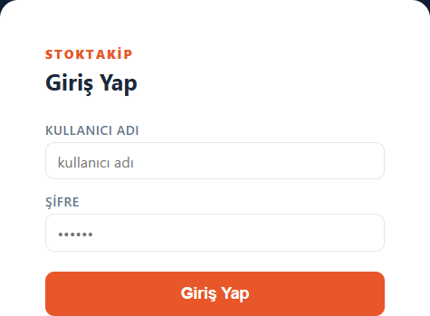
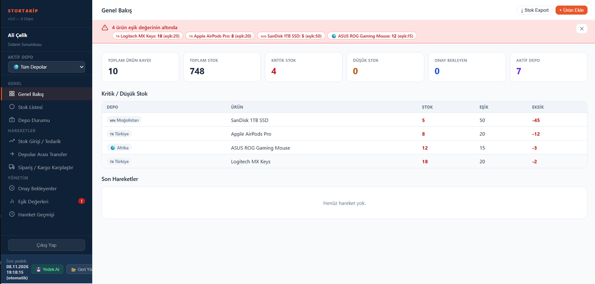
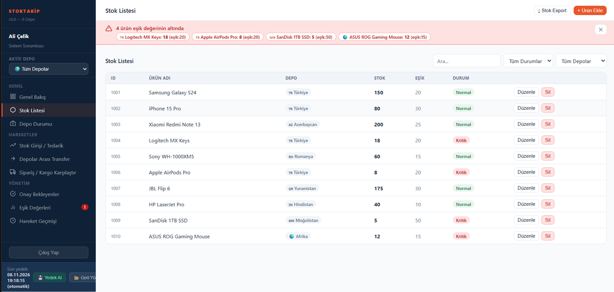
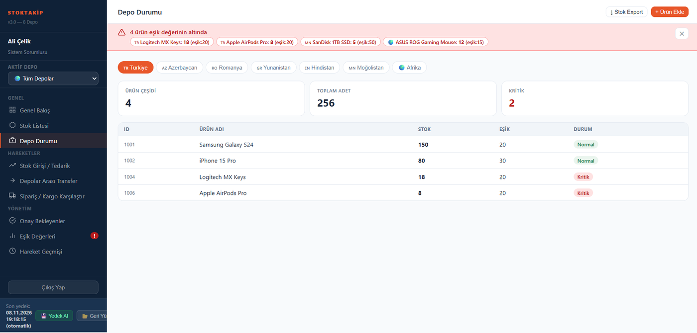
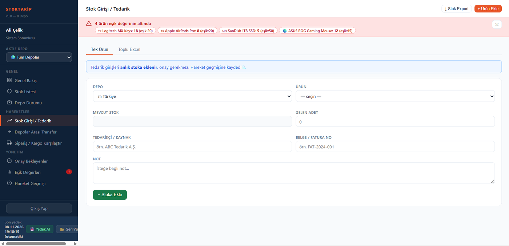
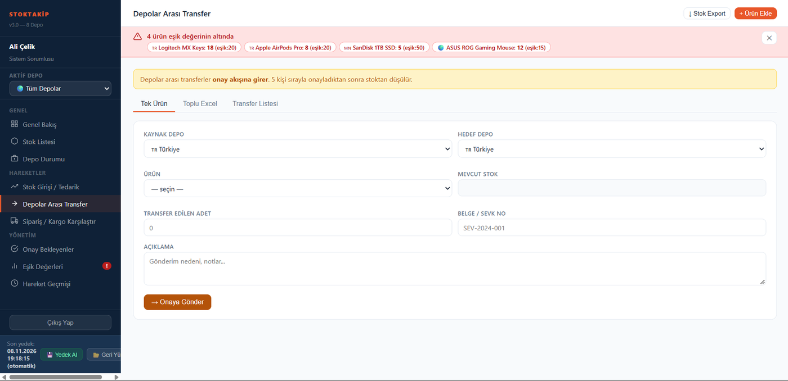
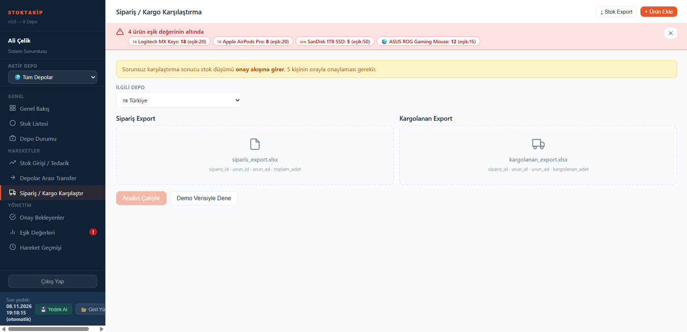
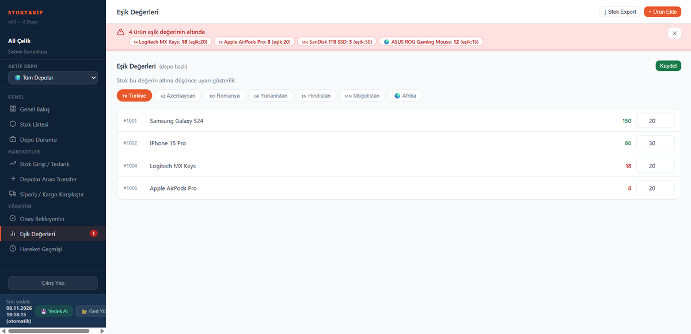
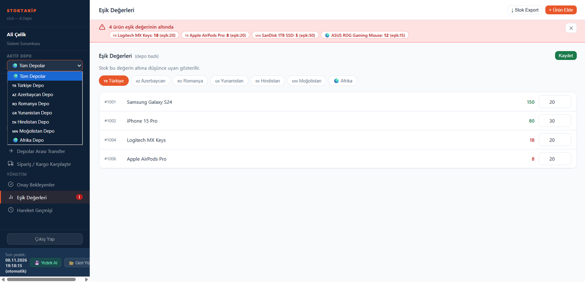

# Multi-Warehouse Stock Tracking System

I built this to keep an eye on stock across several warehouses in different countries. Transfers and shipments don't change the numbers until a chain of five people has approved them, and every warehouse reports its money in its own currency. The whole front end is one HTML file; the data and the live updates come from Supabase.

> Portfolio project. All rights reserved. The repository contains no real company, customer or employee data.

## Try it without any setup (demo mode)

**Live demo: https://yusufydegirmenci.github.io/stock-tracking-app/?demo=1**

Open the link above (or `index.html?demo=1` locally) and sign in. Demo mode needs no Supabase project and no keys: a small in-browser stand-in replaces the database, and everything is **made-up sample data** (no real company, customer or employee). Changes stay in your own browser only, so nobody else sees them and nothing shared can be deleted. The yellow bar at the bottom has a **Demo verisini sıfırla** button that restores the starting data.

| Username | Role |
|---|---|
| `depo1` | Depo Kullanıcısı |
| `depomgr` | Depo Müdürü |
| `stok` | Stok Sorumlusu |
| `sistem` | Sistem Sorumlusu |
| `gmd` | Genel Müdür |

Password for all of them: `demo2026` (public on purpose; it is only for this demo). Sign in as different roles to walk a transfer through the approval chain. The starting data lives in `demo.js` (`seed()`).

## Screenshots

The interface is in Turkish. Sign in with a user from your own Supabase `kullanicilar` table; the role decides which step of the approval chain you can act on. The screenshots use demo data.

| Overview (Genel Bakış) | Stock list (Stok Listesi) |
|---|---|
|  |  |
| **Warehouse status (Depo Durumu)** | **Stock entry (Stok Girişi / Tedarik)** |
|  |  |
| **Inter-warehouse transfer (Depolar Arası Transfer)** | **Order / shipment comparison (Sipariş / Kargo Karşılaştır)** |
|  |  |
| **Low-stock thresholds (Eşik Değerleri)** | **Warehouse selector (Aktif Depo)** |
|  |  |

## How to use

1. **Sign in** and pick the active warehouse in the left sidebar, or leave it on *Tüm Depolar* (all warehouses).
2. **Overview** shows total stock, critical items and pending approvals. A red banner lists every product below its threshold.
3. **Stock list** supports search and filtering by status and warehouse; products can be edited or deleted from the row.
4. **Stock entry / supply** adds stock immediately, with no approval step. Add a single product or upload an Excel file. Every entry is logged in the movement history.
5. **Transfers** between warehouses and **order / shipment comparison** do not change stock right away. They enter the 5-step approval chain and stock is deducted only after all five approvers confirm in order. For the comparison, upload `siparis_export.xlsx` and `kargolanan_export.xlsx` (or try the demo data).
6. **Thresholds** are set per warehouse and drive the low-stock alerts. Save after changing values.
7. **Backup**: the sidebar footer shows the last automatic backup and offers manual backup and restore.

## Features
- **Stock:** per-warehouse stock lists, low-stock thresholds, batch (lot) tracking and expiry dates, periodic stock counts with manager approval
- **Transfers and shipments:** inter-warehouse transfers and order-based stock deduction go through a **5-step sequential approval chain**; duplicate-shipment warnings; order/shipment comparison from Excel exports
- **Proxy approver:** an approver who is away can delegate to a substitute for a date range; actions taken on someone's behalf are flagged in the audit trail
- **Finance:** fixed and variable expenses, revenue and profit per warehouse in the warehouse's **local currency** (TRY, AZN, RON, EUR, INR, MNT, USD), with manual exchange rates and automatic consolidation into TRY
- **Supplier price history:** purchase prices accumulate automatically; a jump of 20% or more raises a warning at entry time
- **KPI and forecasting:** stock turnover, dead stock, supplier performance, expiry tracking, and order suggestions from a weighted moving average with trend detection and a 0–100 confidence score
- **Audit and compliance:** date-range report of user actions, approvals and financial movements
- **Member performance module:** separate from stock and finance, tracks monthly volume, point and commission rankings
- **Real-time sync:** several users see changes instantly (Supabase Realtime)
- **Bilingual UI:** Turkish / English
- **Security hardening:** SHA-256 password hashing with automatic migration, HTML escaping against XSS, login rate limiting (5 failures = 15-minute lockout), 30-minute session timeout with warning, Content Security Policy, login activity log

## Roles
`depo_kullanici` → `depo_mudur` → `stok_sorumlu` → `sistem_sorumlu` → `genel_mudur` (the approval chain follows this order).

## Technology and infrastructure

| Part | What it uses | Notes |
|---|---|---|
| Language | HTML, CSS, JavaScript | No framework and no build step. Everything is in `index.html` (about 1.1 MB). |
| Database | PostgreSQL on Supabase | Tables are listed in the Setup section below. The schema and row-level security policies are not in this repo yet. |
| Live updates | Supabase Realtime | Several people can work at once and see each other's changes. |
| Client library | `supabase-js` v2 | Loaded from the jsDelivr CDN. |
| Excel | SheetJS | Bundled in the page. Used for stock export and for comparing order and shipment files. |
| Fonts | Inter and JetBrains Mono | Loaded from Google Fonts. |
| Hosting | Any static host | There is no server code of my own. Opening `index.html` in a browser also works. |
| Login | The app's own `kullanicilar` table | Passwords are hashed with SHA-256, with a login lockout and a session timeout. There is no Supabase Auth here. |

## Setup
1. Create a Supabase project.
2. In `index.html`, set `SUPABASE_URL` and `SUPABASE_KEY` to your own project's values.
3. Create the tables the app uses: `stok`, `hareketler`, `onaylar`, `lotlar`, `stok_cikis_detay`, `siparis_islemleri`, `sayimlar`, `kullanicilar`, `vekilller`, `ayarlar`, `giris_gunlugu`, `tedarikci_fiyat_gecmisi`, `sabit_giderler`, `degisken_giderler`, `depo_finans`, `doviz_kurlari`, `uyeler`, `uye_aylik_performans`, `qv_cv_yansima`.
   > The SQL schema and row-level security policies are not included in this repository yet.
4. Open `index.html` in a browser (or host it on any static host).

Never commit real keys or data.

## Author
Yusuf Yahya Değirmenci — [GitHub](https://github.com/yusufydegirmenci) · [LinkedIn](https://www.linkedin.com/in/yusufydegirmenci/)
